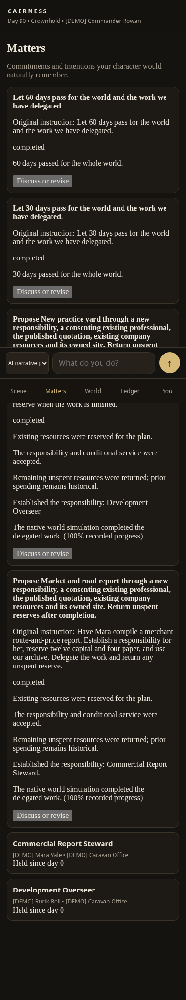

# Different ideas, one planning framework

This demonstration commissions a merchant's report and develops a new practice
yard. The AI model outputs are **scripted test responses**, clearly separated from
the real engine, consent, accounting, projects and save files. The game does not
recognize either request through a special Python gameplay handler.

> Have Mara compile a merchant route-and-price report. Establish a responsibility
> for her, reserve twelve capital and four paper, and use our archive. Delegate the
> work and return any unspent reserve.

> I want a new practice yard for promising fighters. Have our qualified builder
> oversee construction on company land, use twenty capital and ten timber, and
> return any unspent reserve when the work is finished.

Both model-output plans compose the same reusable operations. They establish new
responsibilities, approach existing suitable people, obtain real consent, reserve
existing stock, commission work at a real owned site, and return unspent balances.
They make neither the people nor their willingness appear to satisfy the request.

After 30 days, the report recorded **82%** progress and the yard **41%**. By day 90,
both completed through the native project simulation and remained completed after
save/reload. The first project consumed ten capital and four paper; its unused two
capital returned to the company. The second consumed twenty capital and ten timber.
The world's unrelated events continued while the work proceeded.

## See and reproduce the result

- [Review the proposed scopes in the phone interface](review-scopes.png)
- [Recorded progress after 30 days](day30-progress.png)
- [Both plans after 90 days and page reload](day90-reloaded.png)
- [Machine-readable trajectories for both requests](trajectories.json)
- [Actual focused test output](focused-tests.txt)
- [Regression and integration verification](verification.json)
- [Architecture, assessment and remaining capabilities](../../plans/2026-10-12-general-ai-action-planning.md)



With Python and numpy installed, from this PR's checkout:

```sh
python tools/planning_demo.py --example survey
python tools/planning_demo.py --example yard
```

To use the phone-friendly interface on a computer:

```sh
python tools/planning_demo.py --serve --port 8767
```

Open **http://127.0.0.1:8767**. In Matters, review the original instruction and
engine-listed scope for each project. Authorize the report and yard first, then the
30-day and 60-day time proposals. Reload to see the saved results. These are four
prepared **scripted model proposals**, not a custom interpreter for those phrases.
Typing another idea uses the normal configured local/manual model integration.

Each invocation copies the packaged opening into a fresh temporary save and adds
explicit `[DEMO]` people, an organization, real stock, owned sites and published work
quotations to that copy. The opening itself and World Bible are untouched.

For a configured real local model, arbitrary text goes to the same planner:

```sh
python tools/planning_demo.py --local --intention "Your own idea here"
```

The configured local endpoint was unavailable during validation. The fake-model
HTTP test proves adapter plumbing and the model/tool/plan/review boundary; it does
not prove an LLM's quality at understanding those ideas. Manual ChatGPT/Claude
packets remain available when a local model is unavailable or the router recommends
a stronger model. No remote subscription or new model credentials were installed.

## What was tested

The full suite and final focused checks verify two distinct compositions; normal
acceptance, refusal and counter/explicit acceptance; resource conservation; an
insufficient budget; changed quotations; ordinary conversation and ambiguous ideas;
omitted or unresolved compound conditions; unsupported or contradictory operations;
transactional partial failures; immutable committed prefixes; revised scopes;
work pausing when its worker disappears; save/reload; scoped knowledge and ownership;
and the configured model HTTP adapter. The browser check uses a 390×844 viewport,
actual API calls and persisted state, with no JavaScript errors. It is not a physical
phone benchmark.

The report is a completed manuscript artifact, not automatically verified remote
intelligence. The yard is a completed facility, not a staffed training school.
Broader institutional formation, leases, recruitment, travel, payment contracts,
quote negotiation, educational programs and distributed intelligence still need
general adapters. The architecture document lists those limitations precisely.
