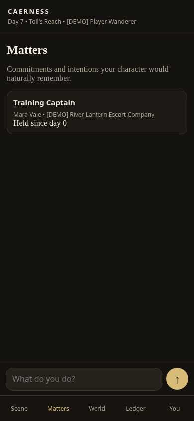

# A responsibility that survives the conversation

This is the first playable appointment loop for issue #2. In the isolated example,
you command an escort company and approach an existing officer, Mara Vale:

> I approach Mara Vale and offer her the Training Captain responsibility.

When she accepts, the game records her office and membership. After seven days and
reopening the save, **Matters** still shows her as Training Captain. In a second
save where her opinion of the commander is hostile, she refuses. The commander's
trust in her does not override her own opinion.

## See the working result

- [Accepted offer, recorded directly from the engine](accepted-transcript.txt)
- [Refusal, recorded directly from the engine](refused-transcript.txt)
- [Appointment on the phone interface](phone-appointment.png)
- [Matters after seven days and page reload](phone-reloaded-matters.png)
- [Targeted test output](targeted-tests.txt)
- [Runtime verification](verification.json)



## Run the demonstration

From a checkout of this PR, with Python and numpy installed:

```sh
python tools/appointment_demo.py
```

For the phone-friendly browser interface:

```sh
python tools/appointment_demo.py --serve
```

Open **http://127.0.0.1:8765** on that computer. Enter the offer above, then
**I wait here for 7 days.** Reload and open **Matters**. Stop the demo with Ctrl+C.
Run `python tools/appointment_demo.py --refusal` to see the alternative refusal;
add `--serve` to play that alternative in the browser.

The demo starts a new temporary world each time. Mara, her company responsibilities
and the command relationship are explicitly authored test fixtures, not changes to
the canonical opening. The packaged database is never opened by the demo.

**Model limitation:** this offline demonstration uses a bounded interpreter stub
for offers to Mara to lead training, and the existing plain rules narrator. It proves
the executor, persistence and phone interface work; it is not a test of literary
prose or arbitrary-language model quality. Normal gameplay uses the existing local
or manual ChatGPT/Claude interpreter path. No live model was available for this run.

## What is implemented

- Natural-language offers reach the typed model contract, instead of being mistaken
  for ordinary conversation or observation.
- The executor checks an existing role, a current organisational decision-maker,
  existing membership, active people, direct presence and a vacant role slot.
- Resource prerequisites come from the existing role's remit (`required_resources`).
  These are availability requirements, not a new payment/spending simulation.
- The existing social resolver uses the recipient's directional opinion, motives,
  existing obligations/workload and seeded uncertainty. Acceptance, refusal and a
  counterproposal remain possible. Acceptance of a counter requires the player's
  response; nothing appoints them on the player's behalf.
- Opportunity proposals, terms, interactions, consent, agreements and appointments
  remain distinct persisted records. Commit revalidates authority, membership,
  resources and vacancy, including delayed/countered offers.
- The narrator receives the committed result, not hidden consent scores, workload
  scores or NPC thoughts. Prose never writes an appointment.
- Own appointments and those within the player's current command are discoverable
  through the scene packet and the mobile Matters view after save/reload.
- Existing Schema 108 saves work without a migration. The SQL action row uses the
  existing `attempt` category; its typed proposal/result retain `appoint`. Stored
  statuses retain the existing vocabulary while result JSON distinguishes refusal,
  a counter and a blocked commitment.

This first slice fills **existing roles with existing members**. New divisions,
new roles, hiring outsiders, payment promises and resource transfers are explicitly
blocked pending their own validated executors. Full multi-turn conversations,
delegated projects, director/fortune rules and Unreal remain subsequent tasks.

## Reproduce verification

```sh
mkdir -p runs/issue2-tmp
TMPDIR="$PWD/runs/issue2-tmp" python tools/run_suite.py --out runs/issue2-suite
python tools/bench_sim.py --segments 1,7 --out runs/issue2-benchmark.json
```

All suite databases and benchmark runs are disposable. Some historical stress tests
use fixed filenames under the temporary directory, so concurrently running suites
must use separate `TMPDIR` directories. The local-model test starts a loopback HTTP
server and needs socket permission in sandboxed environments.

The source revision, suite results/timings, benchmark measurements and unchanged
opening-database hash are recorded in `verification.json`. Source changes preserve
the wider simulation; no simulation subsystem was removed or simplified.
