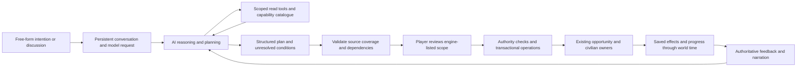

# General AI-to-world planning: first working implementation

The AI is a reasoning and planning component. The engine is an authority boundary,
not a vocabulary of all conceivable player instructions. This implementation lets
different intentions compose the same discoverable operations, while existing
simulation owners continue resolving consent, projects, history and time.

## Assessment of the previous architecture

`actions.py` and the old model contract constrain interpretation to a short list of
gameplay actions. Rich domain functions elsewhere are not discoverable from that
contract. An unknown `attempt` has no execution path, and `speak` immediately rolls
a social interaction. This restricts both complex activities and ordinary sustained
conversation. PR #3 usefully proves consent and persistence, but extending its
appointment-specific recognizer for every new idea would reproduce the problem.

PR #3's separate review-fix commit is `3aea6ef`: ordinary offers are no longer
intercepted by single generic keywords, and appointment interpretations require
explicit review of the appointment-only scope. The full original instruction is
displayed, so an incomplete interpretation cannot execute its subset without a
separate player decision. The general framework below does not call that recognizer.

The architectural references were AGENTS.md, DESIGN.md, POST_V07_ARCHITECTURE.md,
the World Bible and PR #1's audit/brief/narrative-direction clarification. Relevant
World Bible passages concern Stage versus command rank; organizations persisting
through people/property/routine; nonuniform ambition; information travelling through
actual sources; and deterministic state preserving continuity while prose interprets
cultural meaning. No World Bible text, opening history or probability rules changed.
The owner's bounded narrative fortune and uncertain-survival preferences remain
design qualifications; this work introduces no director or survival mechanism.

## Runtime boundary

1. A request goes to the model as unconstrained text, along with the conversation,
   active plans and a dynamically generated catalogue. There is no request-name,
   phrase, example, faction or institution-type dispatch in the planner.
2. The AI can inspect ordinary player perception, records of an organization the
   acting character commands, accessible quotations, and its own plans. It cannot
   read arbitrary tables or NPC private thoughts, resources or opinions.
3. The AI may discuss, clarify, inspect or propose. Discussion is persisted as an
   exchange, not as a contract, emotion change, consent roll or time skip.
4. A plan contains typed operations, dependencies, declared output references,
   source-text coverage and explicit unresolved conditions. Unknown operations,
   contradictory references, omitted text and extra mutation fields return feedback
   for correction. The goal remains in the saved session.
   Clarification goals are carried separately from the short conversational context
   window. Later utterances in that unresolved thread, and revisions to an existing
   plan, append their exact text to the bound intention before the model responds.
   They cannot disappear merely because the model labels them casual discussion.
5. No model response can authorize execution. The player reviews the original
   instruction, the AI's proposed summary and **engine-authored operation scopes**.
   The explicit authorization pins a revision digest. Unresolved conditions block it.
6. Each operation checks actual authority and current prerequisites. Each step has
   a savepoint; a failed resource reservation cannot leave a half debit. Previously
   committed steps remain historical rather than being rolled back or rerolled.
7. Native consent can accept, refuse or counter. Only the actual recipient can
   explicitly answer a pending proposal. Terms and quotation fingerprints are
   checked again by the native opportunity executor on acceptance, including counters.
8. Native projects advance through the shared simulation. A due process observes
   completed work, continues already-authorized dependencies such as returning
   unspent reserves, and pauses work if its established personnel/site disappear or
   the native health profile supplies no functional capacity. Actual capacity scales
   labor through the existing civilian project field; no medical resolver is added.
   No background LLM or player presence is required for these existing processes.
9. Execution feedback can be returned to the planner to propose a revised scope or
   ask a question. A revision preserves committed effects even after a project pauses;
   new consequences require new player review. The normal narrator receives engine
   results, not authority to invent them.

Source coverage is a mechanical completeness guard, not a proof that a language
model interpreted every clause correctly. The complete initial source is retained;
follow-up text is appended, never substituted. Reviewed revisions stay in history and
the engine independently enumerates the operations being authorized. This avoids
using an AI's own claim of completeness or persuasive summary as authorization.
The system does not claim perfect semantic verification of arbitrary language.

## Initial discoverable capabilities

| Capability | Existing owner and constraints |
|---|---|
| `define_role` | `adaptive_planning.create_role`; existing organization and current decision-maker; established competence domain; staff responsibility only, no sovereign rights or mastery |
| `offer_service` | Opportunity proposals/terms, recipient-owned native consent, institutional appointment and service engagement; real person, direct contact, suitable competence, published quotation and vacancy |
| `allocate_resources` | Existing `resources` plus plan escrow; positive finite actual quantities, current organizational authority, conserved debits; cumulative reservation preflight |
| `commission_work` | `civilian.create_project`; accepted service, quoted requirements, reserved stock, owned real site, declared site capacity and available suitable worker; native completion creates a manuscript/artifact or building |
| `refund_resources` | Original-owner escrow balance; returns only unspent stock, once; never recovers already consumed inputs |
| `advance_time` | `simulation.advance_connection`; explicit reviewed time skip for the whole world, without exposing offscreen event summaries |
| `answer_proposal` | `interactions.apply_player_response`; only a pending proposal's actual recipient, with the original domain commit guard |

New arrangements have free-form names and remits. A role need not already exist by
name in the opening. A validated command decision establishes a responsibility;
NPC consent and actual materials/site/time remain separate prerequisites.
Descriptions cannot themselves grant property, extra promises or legal rights.

Quotations reuse `seekable_offerings` with a `work_order` metadata contract:
project kind, exact resource requirements, duration target, suitable site kinds and
minimum competence. The provider must be present and the offering accessible.
These terms are stored world records, never numbers invented by a planner to make
a request pass. The generic metadata contract can describe different work; it is
not a survey or training-yard action type. Universal currency calibration remains
an unresolved World Bible issue; the implementation conserves the engine's existing
resource units and makes no currency conversion assumptions.

## Persistence and integration

`planning_schema.sql` installs optional planning protocol schema v1 transactionally
on first use, without rewriting legacy Schema 108 columns or the packaged opening.
Plans, revisions, source text, approvals, step results, events, reserves and links to
native work persist. Completed/committed steps cannot be changed by a revision,
including steps whose already-created project subsequently becomes blocked.

`planning_gateway.py` uses the existing persisted `action_interpretation` request
transport with a versioned protocol. The model can request scoped tools repeatedly,
receive feedback and formulate a plan. Local OpenAI-compatible/Ollama and manual
ChatGPT/Claude packets share this protocol. The existing quality/context router is
respected; explicit local forcing remains available. Tool/correction loops are
bounded and stop for discussion, clarification or player review.

The mobile input defaults to AI narrative play; the existing play and offline rules
remain available. Scene contains conversation, Matters shows plan reviews and real
progress. Discuss/revise resumes the saved plan, while a new idea keeps previous
goals intact. Ordinary conversation has no implicit world-changing commitment.
Plan-approval results enter the existing narrator/turn boundary, and blocked or
refused results can produce another planning request with authoritative feedback.

No unrestricted SQL, arbitrary Python call, model-authored resource balance, or
unvalidated new-person operation is exposed. The executors take an acting person
and check the same world authority; they do not grant the camera a private privilege.

## Evidence and exact limits

See [the playable examples and actual results](../demos/general-planning/README.md).
Two different requests use the exact same five-operation composition:
define responsibility → seek consent → reserve stock → commission work → refund.
One produces a merchant report manuscript; the other produces a physical practice
yard. Both progress and complete through the existing world simulation, including
save/reload. No request-specific Python handler was added.

These examples are explicitly authored world/quotation fixtures on copies of the
opening and use scripted model responses. An HTTP integration test exercises the
real model adapter with a fake server. The configured real endpoint was checked and
attempted, but localhost:8080 refused the connection; there is no real-LLM reasoning,
literary prose, or physical-phone performance acceptance claim.

The following reusable capabilities still need adapters or deeper native owners:

- Founding legally recognized institutions/subdivisions and funded enterprises,
  with culture/law/property/capital/personnel requirements rather than merely names.
- Acquiring or leasing premises from existing property records; the initial work
  adapter accepts quantified, owned strategic sites, not every existing building.
- Negotiating and publishing new quantified quotations, payment schedules, gifts,
  asset transfer, credit, recurring wages and contractual rights. This slice uses
  already-published quotations and conserves abstract resource stocks.
- Travel and contact arrangements, remote delegated recruitment, latent population
  discovery, aggregate workforce assignment and informant/operational reporting.
- Suspending, resuming or replacing an already-committed work engagement after
  means change; this slice pauses and preserves it, without inventing substitutes.
- Actual educational programs, instructor/pupil recruitment and transmission after
  building a facility. A practice yard is not a completed staffed school.
- Report substance and information collection: a report manuscript is a real work
  artifact, not automatic true intelligence about distant kingdoms or new prices.
- Richer NPC conversation initiative/personality and human literary evaluation.

Thus the full twenty-person southern intelligence network and a staffed new school
are not claimed complete. Missing components are generic contact, organizational,
workforce, finance, education and information adapters. They can expand the same
framework without adding an `establish_intelligence_network` or `establish_school`
command or recognizer. Unreal and 3D are outside this task.
